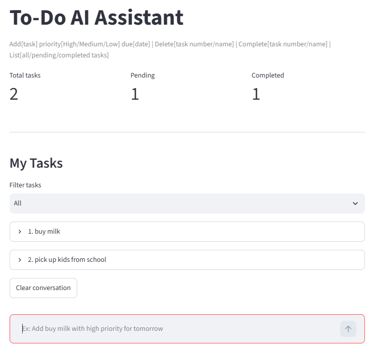
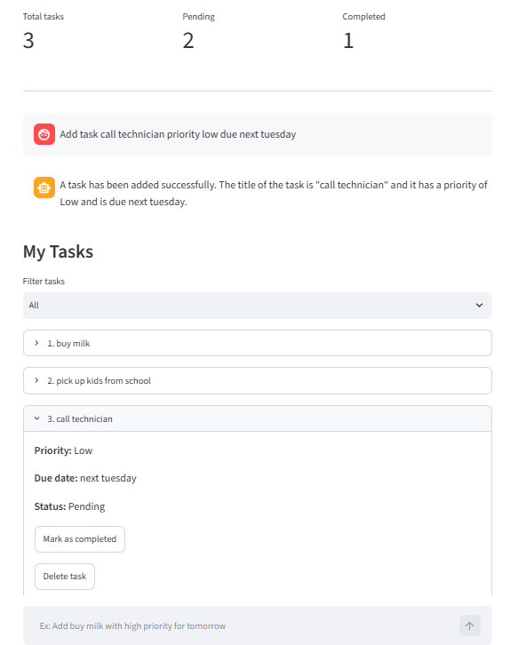
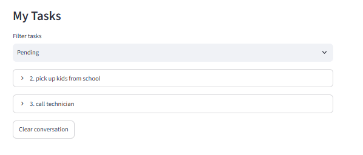
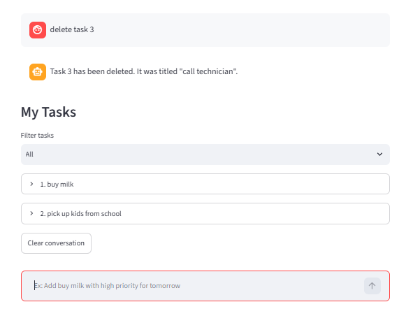

# To-Do AI Assistant (basic AI agent)
The LLM chooses when to call Python functions (tools) to add, list, or complete tasks. Tasks are saved locally in `tasks.json`. No OpenAI API key is needed.

## Setup
1. Install Ollama:irm https://ollama.com/install.ps1 | iex
2. Download model:ollama pull qwen2.5:3b
3. Install requirements:py -m pip install -r requirements.txt
4. Run progranm:py -m streamlit run app.py

Example of trial, write in imput:
- Add call technician with high priority and due date tomorrow
- Show my tasks
- Complete task 1
- Delete task number 1
(they don't have to have this specific wording)

## Agent flow
User request -> LLM chooses a tool -> Py function runs -> tool result goes back to the LLM -> final response.

OPnly changes its local task list. 

